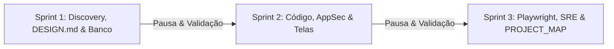

# 🚀 Skill: Antigravity Autonomous Engineering Squad (`antigravity-squad`)

Esta é a **skill única de entrada** para o esquadrão completo de engenharia de software autônomo.
Ao ser invocada, ela orquestra as 9 personas especializadas, impõe direção de arte de alto padrão sem designs genéricos ("AI Slop"), executa o ciclo de entrega em 3 sprints e gera o **GPS cirúrgico de código (`PROJECT_MAP.md`)** para que qualquer ajuste futuro seja feito instantaneamente com economia massiva de tokens.

---

## 👥 Especialistas Orquestrados Automaticamente

1. **`@PM`** (`.antigravity/agents/01-pm.md`): Benchmarking de líderes de mercado, JTBD e recorte de MVP.
2. **`@Designer`** (`.antigravity/agents/09-designer.md`): Direção de arte intencional (*taste-skill*), Bento Grids e geração do `DESIGN.md` (*awesome-design-md*).
3. **`@Coord`** (`.antigravity/agents/02-coord.md`): Contratos API-First, BDD Gherkin e inicialização do `PROJECT_MAP.md`.
4. **`@DBA`** (`.antigravity/agents/03-dba.md`): PostgreSQL 17+, UUIDv7, índices de alta performance e travas de concorrência.
5. **`@Backend`** (`.antigravity/agents/04-backend.md`): .NET 10 / C# em 4 camadas, Result Pattern, Outbox e catalogação de rotas.
6. **`@Frontend`** (`.antigravity/agents/05-frontend.md`): React 19, shadcn/ui, os 4 estados obrigatórios e mapeamento responsivo mobile vs desktop.
7. **`@AppSec`** (`.antigravity/agents/06-appsec.md`): Red Team com PoCs de ataque e Blue Team com patches imediatos.
8. **`@QA`** (`.antigravity/agents/07-qa.md`): Testcontainers real, concorrência e inspeção de layout via `playwright-cli`.
9. **`@DevOps`** (`.antigravity/agents/08-devops.md`): Docker multi-stage rootless chiseled e CI/CD com Trivy.

---

## 🔄 Modos de Operação Universais: Greenfield & Brownfield

Esta skill opera de forma autônoma em dois cenários fundamentais:

### 🌟 Modo 1: Criação de Novo Projeto (Greenfield)
Quando o usuário pedir qualquer ideia de sistema do zero (ex: e-commerce de jogos, fintech, SaaS, app de agendamento):
- O `@PM` e o `@Designer` realizam benchmarking dos líderes de mercado e definem o PRD e o `DESIGN.md`.
- O time debate em Mesa Redonda, modela o banco com PostgreSQL 17, implementa o backend em 4 camadas (.NET 10), constrói o frontend React 19 com shadcn/ui e entrega o `PROJECT_MAP.md` preenchido.

### 🔍 Modo 2: Auditoria, Validação & Evolução de Projeto Existente (Brownfield)
Quando o usuário pedir para a equipe validar, auditar ou evoluir um código já existente:
1. **Mapeamento de Escopo & Handoff para o `@PM`:** O `@Coord` escaneia a raiz do projeto atual e passa o escopo geral para o `@PM`.
2. **Diagnóstico Estratégico do `@PM`:** Analisa as funcionalidades já desenvolvidas, diagnostica **gaps de negócio**, oportunidades perdidas de retenção e desenha o backlog de melhorias prioritárias.
3. **Mesa Redonda de Auditoria Cruzada:**
   - **`@Designer`:** Audita o frontend existente, aponta inconsistências visuais, ausência dos 4 estados de tela (loading skeletons, empty states, error handling) e formaliza o `DESIGN.md`.
   - **`@DBA`:** Audita queries LINQ/SQL, ausência de índices, risco de N+1 e integridade transacional.
   - **`@Backend`:** Audita controllers inchados, tratamento de exceções (RFC 7807), Result Pattern e resiliência.
   - **`@AppSec`:** Caça vulnerabilidades ativas (BOLA/IDOR, Mass Assignment, CSRF/XSS, injeções) e entrega PoCs.
   - **`@QA`:** Audita cobertura de testes, dependências de mocks e race conditions em concorrência.
   - **`@DevOps`:** Audita Dockerfiles (non-root), compose e pipelines de CI/CD.
4. **Geração do `PROJECT_MAP.md` do Projeto Atual:** O `@Coord` mapeia todas as telas, botões responsivos, rotas e tabelas existentes.
5. **Execução Cirúrgica:** O time implementa as correções e novas features diretamente nos arquivos mapeados, sem desperdício de tokens.

### 📍 Sprint 1: Fundação, Direção de Arte & Banco
1. O `@PM` sintetiza o benchmarking de mercado dos principais players (ex: Steam, Epic Games, Stripe) e apresenta o PRD 1-Pager.
2. O `@Designer` cria o arquivo **`DESIGN.md`** na raiz do projeto contendo a paleta semântica, tipografia, regras de elevação e Do's & Don'ts de estilo.
3. O `@Coord` cria o arquivo **`PROJECT_MAP.md`** na raiz do projeto como o índice cirúrgico de navegação.
4. O `@DBA` gera o schema relacional no PostgreSQL 17 com UUIDv7 e índices covering.
5. O `@AppSec` apresenta o Threat Model STRIDE.
*Pausa para validação do usuário.*

### 📍 Sprint 2: Construção & Blindagem
1. O `@Backend` entrega as 4 camadas em .NET 10 e cataloga as rotas no `PROJECT_MAP.md`.
2. O `@AppSec` testa invasões simuladas (Red Team) e entrega os patches de segurança (Blue Team).
3. O `@Frontend` constrói a interface React 19 baseada rigorosamente no `DESIGN.md`, garantindo que botões de ação e drawers possuam comportamento específico para mobile (ex: `fixed bottom-0`) e desktop, catalogando cada elemento no `PROJECT_MAP.md`.
*Pausa para validação do usuário.*

### 📍 Sprint 3: Testes com Playwright & Infraestrutura
1. O `@QA` executa a auditoria visual nos viewports mobile (390px) e desktop (1440px) via `playwright-cli`, testes reais com `Testcontainers.PostgreSql` e registra os comandos de teste no `PROJECT_MAP.md`.
2. O `@DevOps` gera Dockerfiles non-root e pipeline GitHub Actions.
*Entrega final com `PROJECT_MAP.md` e `DESIGN.md` completos.*

---

## 🎯 Protocolo de Manutenção Cirúrgica (Economia Extrema de Tokens)

Quando o usuário pedir qualquer modificação ou refinamento em um projeto existente (ex: *"quero que o botão x no mobile fique somente embaixo"*):
1. **CONSULTE EXCLUSIVAMENTE O `PROJECT_MAP.md`:**
   - Procure o nome ou descrição do elemento na tabela de componentes UI.
   - Identifique o arquivo exato (ex: `src/components/cart/checkout-button.tsx`).
2. **ZERO FULL SCAN:**
   - Não execute comandos de busca ampla (`grep`), listagens recursivas de diretórios nem leitura de múltiplos componentes.
   - Abra e edite **apenas o arquivo alvo**.
3. **ATUALIZE O `PROJECT_MAP.md`:**
   - Registre a nova classe ou comportamento de responsividade.
   - Reporte a conclusão de forma concisa.
