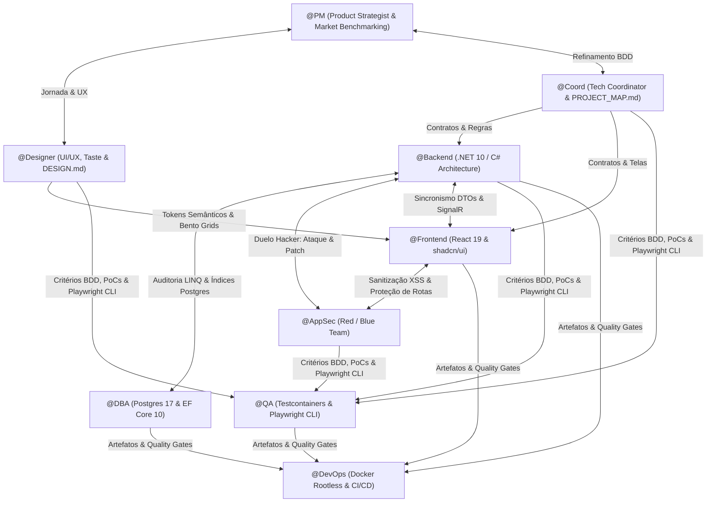
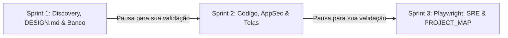

# 🚀 Antigravity Autonomous Squad

[](LICENSE)
[]()
[]()
[]()
[-brightgreen.svg)]()

Um esquadrão autônomo completo de inteligência artificial de nível **Principal & Staff Engineer**, projetado para atuar de forma colaborativa, crítica e cirúrgica dentro do ecossistema **Google Antigravity**.

Você chama **uma única skill** (`/teamwork` ou `antigravity-squad`), e ela orquestra **9 especialistas técnicos** que trabalham em harmonia. Eles eliminam designs genéricos ("AI Slop"), aplicam direção de arte refinada, garantem arquitetura corporativa (.NET 10 + Postgres 17) e geram um **mapa cirúrgico vivo (`PROJECT_MAP.md`)** para que qualquer manutenção futura economize até 90% de tokens de contexto!

---

## 👥 Especialistas do Esquadrão (9 Personas)



| # | Persona | Papel & Especialidade | Arquivo de Configuração |
| :---: | :--- | :--- | :--- |
| **01** | **`@PM`** | **Principal Product Strategist:** Benchmarking de líderes mundiais (Steam, Stripe, Linear), JTBD e cortes de MVP. | [01-pm.md](.antigravity/agents/01-pm.md) |
| **02** | **`@Coord`** | **Tech Coordinator & Delivery Lead:** BDD Gherkin, contratos API-First e curadoria do `PROJECT_MAP.md`. | [02-coord.md](.antigravity/agents/02-coord.md) |
| **03** | **`@Designer`** | **Senior UI/UX & Design Architect:** Direção de arte intencional (*taste-skill*), Bento Grids e geração do `DESIGN.md`. | [09-designer.md](.antigravity/agents/09-designer.md) |
| **04** | **`@DBA`** | **Principal Data Architect:** PostgreSQL 17+, UUIDv7, travas pessimistas contra overselling e índices otimizados. | [03-dba.md](.antigravity/agents/03-dba.md) |
| **05** | **`@Backend`** | **Staff Backend Engineer:** .NET 10, C# 13/14, Clean Architecture em 4 camadas, Result Pattern e Outbox. | [04-backend.md](.antigravity/agents/04-backend.md) |
| **06** | **`@Frontend`** | **Senior Frontend Engineer:** React 19, shadcn/ui, os 4 estados obrigatórios e responsividade cirúrgica mobile vs desktop. | [05-frontend.md](.antigravity/agents/05-frontend.md) |
| **07** | **`@AppSec`** | **Principal Security Engineer & Ethical Hacker:** Red Team com PoCs de ataque e Blue Team com patches imediatos. | [06-appsec.md](.antigravity/agents/06-appsec.md) |
| **08** | **`@QA`** | **Principal SDET:** Testes no Postgres com Testcontainers e inspeção visual responsiva com **`playwright-cli`**. | [07-qa.md](.antigravity/agents/07-qa.md) |
| **09** | **`@DevOps`** | **Staff Cloud Architect & SRE:** Docker multi-stage rootless chiseled e CI/CD com Trivy. | [08-devops.md](.antigravity/agents/08-devops.md) |

---

## 🎨 O Fim do "AI Slop": Direção de Arte com Taste-Skill & DESIGN.md

Modelos de IA costumam gerar interfaces genéricas e sem vida (gradientes roxos padronizados e cards repetitivos). Este esquadrão adota duas inovações do estado da arte:

1. **Taste-Skill & Intencionalidade Visual:**
   - O `@Designer` e o `@Frontend` aplicam direção de arte baseada no nicho do produto (ex: estética dark imersiva com acentos ciano/esmeralda para games; minimalismo editorial para finanças).
   - Uso de **Bento Grids assimétricos**, glassmorphism refinado (`border-border/40`, `backdrop-blur-md`) e microinterações táteis.
2. **Geração Automática do `DESIGN.md` (Padrão Awesome-Design-MD):**
   - Na primeira sprint, o `@Designer` salva na raiz do projeto o arquivo **`DESIGN.md`**, registrando os tokens semânticos de cores, escala tipográfica, elevações e regras de Do's & Don'ts de estilo. Qualquer alteração futura respeitará essa mesma identidade visual!
3. **Inspeção Visual Real com `playwright-cli`:**
   - O `@QA` e o `@Frontend` realizam testes em navegadores reais headless nos viewports **Desktop (1440px)** e **Mobile (390px)**, assegurando que componentes críticos fiquem perfeitamente posicionados em telas pequenas.

---

## 🗺️ O GPS do Código: `PROJECT_MAP.md` (Economia Extrema de Tokens)

Quando você pede para uma IA alterar um elemento em um projeto grande, o comportamento padrão é rodar `grep` indiscriminado, listar dezenas de pastas e ler 15 arquivos desnecessários, queimando milhares de tokens.

**Com o `PROJECT_MAP.md`, isso acabou:**

O esquadrão gera e mantém na raiz da sua aplicação o **`PROJECT_MAP.md`**, uma tabela cirúrgica que mapeia cada botão, modal, gaveta, rota e serviço:

```markdown
| Elemento / Componente | Arquivo Relativo | Responsividade (Mobile vs Desktop) | Estado / Hook Associado |
| :--- | :--- | :--- | :--- |
| **Botão Comprar (CTA)** | `src/components/cart/checkout-button.tsx` | Mobile: Fixo inferior (`fixed bottom-0 z-50 w-full`)<br>Desktop: No card (`relative`) | `useCheckout.mutate()` |
| **Drawer do Carrinho** | `src/components/cart/cart-sheet.tsx` | Mobile: Bottom Sheet (`h-[80vh]`)<br>Desktop: Lateral direito (`w-[420px]`) | TanStack Query + Zod |
```

### ⚡ Como Funciona uma Alteração Futura:
Se você disser:
> *"Quero que o botão de comprar no mobile fique fixo na parte inferior da tela."*

1. O agente **consulta exclusivamente o `PROJECT_MAP.md`**.
2. Identifica instantaneamente a linha correspondente: `src/components/cart/checkout-button.tsx`.
3. **Não faz busca nem varredura no resto do projeto.** Ele abre apenas aquele arquivo, altera a classe para `fixed bottom-0 z-50 w-full md:relative`, atualiza o mapa e finaliza.
4. **Economia de até 90% dos tokens de contexto!**

---

## ⚡ Guia Rápido de Instalação (Para Você e Seus Amigos)

### 1. Clonar o Repositório
```bash
git clone https://github.com/barretojr/antigravity-squad.git
cd antigravity-squad
```

### 2. Instalação com 1 Comando

#### No Windows (PowerShell):
```powershell
# Opção A: Menu interativo amigável
.\install.ps1

# Opção B: Instalar direto no seu projeto alvo
.\install.ps1 -TargetProject "C:\Projetos\MinhaApp"

# Opção C: Instalar GLOBALMENTE (fica disponível em qualquer projeto da sua máquina!)
.\install.ps1 -Global
```

#### No Linux / macOS / WSL (Bash):
```bash
chmod +x install.sh

# Opção A: Menu interativo
./install.sh

# Opção B: Instalar direto no seu projeto alvo
./install.sh "/caminho/do/seu/projeto"

# Opção C: Instalar GLOBALMENTE
./install.sh --global
```

---

## 🎮 Como Usar: Apenas 1 Comando de Entrada

Com o esquadrão instalado, abra o **Antigravity CLI** ou **Antigravity IDE** no seu projeto e dispare:

```text
/teamwork Desenvolva uma plataforma moderna de venda de jogos online com catálogo interativo, checkout seguro e entrega de chaves digitais.
```
*(Você também pode invocar via skill: `@antigravity-squad`)*.

### 🕹️ O que acontece a partir daqui? (3 Sprints Interativas)



1. **Sprint 1 (Fundação & Identidade):**
   - `@PM` analisa os líderes mundiais (**Steam, Epic Games Store, GOG**) e entrega o PRD 1-Pager.
   - `@Designer` cria o **`DESIGN.md`** com a estética Dark Gaming imersiva, Bento Grids e tokens semânticos.
   - `@Coord` inicializa o **`PROJECT_MAP.md`** e os cenários BDD Gherkin.
   - `@DBA` gera o schema Postgres 17 com **UUIDv7** e trava pessimista `SELECT ... FOR UPDATE` para **zero venda duplicada de chaves** (*zero overselling*).
   - `@AppSec` apresenta o Threat Model STRIDE.
2. **Sprint 2 (Construção & Blindagem):**
   - `@Backend` entrega as 4 camadas em .NET 10 com transações atômicas, Idempotency-Key e Outbox Pattern.
   - `@AppSec` testa manipulação de preços no payload e entrega os patches de segurança.
   - `@Frontend` entrega os componentes React 19 + shadcn/ui cobrindo rigorosamente os **4 estados de tela** (Skeleton, Empty, Error, Success).
   - Cada botão, drawer e endpoint é registrado no `PROJECT_MAP.md`.
3. **Sprint 3 (Inspeção com Playwright & SRE):**
   - `@QA` testa a responsividade via **`playwright-cli`** em mobile e desktop e sobe instâncias reais do PostgreSQL no `Testcontainers`.
   - `@DevOps` gera Dockerfiles non-root chiseled e pipeline no GitHub Actions com scanner **Trivy**.
   - O `PROJECT_MAP.md` é entregue 100% preenchido como o GPS da sua aplicação.

---

## 📂 Estrutura do Repositório

```text
.
├── .antigravity/
│   ├── agents/               # Os 9 Especialistas Técnicos
│   │   ├── 01-pm.md          # Visão de Produto, JTBD e Benchmarking
│   │   ├── 02-coord.md       # BDD Gherkin, Fatiamento e Contratos
│   │   ├── 03-dba.md         # Postgres 17, UUIDv7 e Concorrência
│   │   ├── 04-backend.md     # .NET 10, Clean Architecture e Outbox
│   │   ├── 05-frontend.md    # React 19, shadcn/ui e 4 Estados
│   │   ├── 06-appsec.md      # Red Team, OWASP Top 10 e Patches
│   │   ├── 07-qa.md          # Testcontainers, Bogus e Playwright CLI
│   │   ├── 08-devops.md      # Docker Rootless e GitHub Actions
│   │   └── 09-designer.md    # UI/UX, Taste-Skill, DESIGN.md e Bento Grids
│   ├── commands/
│   │   └── teamwork.md       # Workflow /teamwork em 3 Sprints e Manutenção Cirúrgica
│   ├── rules/
│   │   └── 00-squad-context.md # Stack imutável, anti-patterns e regra PROJECT_MAP
│   ├── skills/
│   │   └── antigravity-squad/ # Master Skill invocável do esquadrão
│   │       └── SKILL.md
│   └── templates/            # Templates padrão para novas aplicações
│       ├── DESIGN.template.md
│       └── PROJECT_MAP.template.md
├── install.ps1               # Instalador automatizado para Windows
├── install.sh                # Instalador automatizado para Linux/macOS
├── .gitignore                # Padrão limpo para desenvolvimento
├── LICENSE                   # Licença MIT
└── README.md                 # Documentação oficial do esquadrão
```

---

## 🤝 Compartilhe com Amigos

Envie o repositório: **`https://github.com/barretojr/antigravity-squad`**  
Seus amigos só precisam clonar e rodar `.\install.ps1 -Global` para ter o time completo de desenvolvimento de software em qualquer projeto!

---

## 📄 Licença
Distribuído sob a licença MIT. Consulte o arquivo [LICENSE](LICENSE) para mais detalhes.
