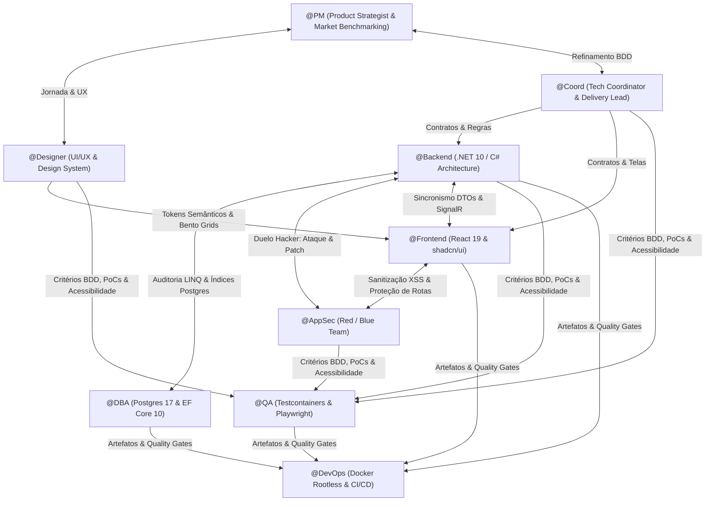
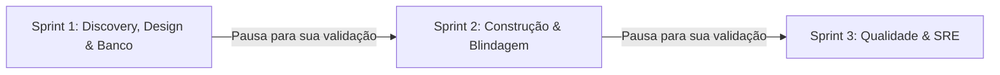

# 🚀 Antigravity Autonomous Squad

[](LICENSE)
[]()
[]()
[]()

Um esquadrão autônomo de inteligência artificial de nível **Principal & Staff Engineer**, projetado para atuar de forma colaborativa, crítica e autônoma dentro do ecossistema **Google Antigravity**.

Em vez de atuar como geradores isolados de código que precisam de instruções óbvias para cada tabela ou botão, os agentes operam com **Autonomia de Domínio & Benchmarking Proativo**. Eles pesquisam o estado da arte do mercado, tomam decisões técnicas e visuais de alto impacto, debatem em **Mesa Redonda**, refinam contratos de integração e impõem **Portões de Validação Cruzada (Quality Gates)** antes de finalizar qualquer entrega.

---

## 👥 Especialistas do Esquadrão (9 Personas)



| # | Persona | Papel & Especialidade | Arquivo de Configuração |
| :---: | :--- | :--- | :--- |
| **01** | **`@PM`** | **Principal Product Strategist:** Benchmarking de mercado, JTBD, 5 Porquês, North Star e corte cirúrgico para MVP. | [01-pm.md](.antigravity/agents/01-pm.md) |
| **02** | **`@Coord`** | **Tech Coordinator & Agile Lead:** Quebra em PBIs verticais, critérios BDD Gherkin e contratos API-First. | [02-coord.md](.antigravity/agents/02-coord.md) |
| **03** | **`@DBA`** | **Principal Data Architect:** PostgreSQL 17+, UUIDv7, concorrência `xmin`, índices parciais e migrations seguras. | [03-dba.md](.antigravity/agents/03-dba.md) |
| **04** | **`@Backend`** | **Staff Backend Engineer:** .NET 10, C# 13/14, Clean Architecture em 4 camadas, Result Pattern e Outbox. | [04-backend.md](.antigravity/agents/04-backend.md) |
| **05** | **`@Frontend`** | **Senior Frontend Engineer:** React 19, TypeScript estrito, shadcn/ui, TanStack Query e os 4 estados obrigatórios. | [05-frontend.md](.antigravity/agents/05-frontend.md) |
| **06** | **`@AppSec`** | **Principal Security Engineer & Ethical Hacker:** Red Team com PoCs de ataque e Blue Team com patches imediatos. | [06-appsec.md](.antigravity/agents/06-appsec.md) |
| **07** | **`@QA`** | **Principal SDET:** Testes reais com `Testcontainers.PostgreSql`, concorrência e Playwright E2E com acessibilidade. | [07-qa.md](.antigravity/agents/07-qa.md) |
| **08** | **`@DevOps`** | **Staff Cloud Architect & SRE:** Docker multi-stage rootless chiseled, Migration Bundles e GitHub Actions com Trivy. | [08-devops.md](.antigravity/agents/08-devops.md) |
| **09** | **`@Designer`** | **Senior UI/UX & Design System Architect:** Benchmarking visual (Steam, Linear, Vercel), Bento Grids, paletas dark e microinterações. | [09-designer.md](.antigravity/agents/09-designer.md) |

---

## 🧭 Sobre a Pasta `.antigravity`: Como Funciona a Descoberta?

> **Dúvida comum:** *Por que o repositório utiliza a pasta `.antigravity`? Seria prudente mudar?*

O **Google Antigravity** segue uma convenção nativa de descoberta hierárquica baseada em pastas de contexto (como `.antigravity/` ou `.agents/`) localizadas na raiz do seu projeto de trabalho:
- Ao abrir um projeto que contém `.antigravity/`, o Antigravity carrega instantaneamente as regras (`rules/`), comandos customizados (`commands/`) e perfis de especialistas (`agents/`).
- Para facilitar a distribuição entre amigos e múltiplos projetos, este repositório traz **scripts automatizados de instalação** (`install.ps1` e `install.sh`). Você pode escolher entre instalar **no projeto atual** ou **globalmente na sua máquina**!

---

## ⚡ Guia Rápido de Instalação (Para Você e Seus Amigos)

### 1. Clonar o Repositório
```bash
git clone https://github.com/barretojr/antigravity-squad.git
cd antigravity-squad
```

### 2. Instalação com 1 Comando

#### No Windows (PowerShell):
```powershell
# Opção A: Menu interativo amigável
.\install.ps1

# Opção B: Instalar direto no seu projeto alvo
.\install.ps1 -TargetProject "C:\Projetos\MinhaApp"

# Opção C: Instalar GLOBALMENTE (fica disponível em qualquer projeto da sua máquina!)
.\install.ps1 -Global
```

#### No Linux / macOS / WSL (Bash):
```bash
chmod +x install.sh

# Opção A: Menu interativo
./install.sh

# Opção B: Instalar direto no seu projeto alvo
./install.sh "/caminho/do/seu/projeto"

# Opção C: Instalar GLOBALMENTE
./install.sh --global
```

#### Instalação Manual (Sem Scripts):
Se preferir, basta copiar a pasta `.antigravity` para dentro da raiz de qualquer projeto em que você for trabalhar:
```powershell
Copy-Item -Recurse -Path ".\.antigravity" -Destination "C:\SeuProjeto\.antigravity"
```

---

## 🎮 Como Usar: O Poder da Decisão Autônoma

Com o esquadrão instalado, abra o **Antigravity CLI** ou **Antigravity IDE** no seu projeto e dispare o comando `/teamwork` no chat:

```text
/teamwork Desenvolva uma plataforma moderna de venda de jogos online com catálogo interativo, checkout seguro e entrega de chaves digitais.
```

### O que acontece a partir daqui? (Magia em 3 Sprints)
Você **não precisa** ficar respondendo 20 perguntas óbvias sobre autenticação, banco ou carrinho. O time assume o domínio e decide com base nas melhores práticas do mercado:



#### 🕹️ Exemplo Real de Decisões Tomadas pelo Time:
1. **`@PM` (Estratégia de Negócio):**
   - Ativa benchmarking direto dos líderes mundiais: **Steam, Epic Games Store e GOG**.
   - Modela o core do produto: catálogo com filtros de gênero/desconto, bundles promocionais, sistema de wishlist, avaliação da comunidade e biblioteca do jogador.
   - Aplica os cortes cirúrgicos do MVP para entrega rápida de alto impacto.
2. **`@Designer` (Identidade Visual & UI/UX):**
   - Projeta uma estética **Dark Gaming Imersiva** (tons profundos de slate/zinc com acentos em ciano neon e esmeralda).
   - Desenha um **Bento Grid** dinâmico com Hero banner para trailers, cards de jogos com badges de plataforma (PC/Console) e microinterações táteis no hover.
   - Especifica um **Drawer de Checkout (Sheet)** rápido, permitindo comprar sem sair da vitrine.
3. **`@Coord` (Engenharia de Contratos):**
   - Escreve os cenários de aceite em **BDD Gherkin** (*Dado que o usuário tem fundos / Quando comprar a chave / Então deve reservar com exclusividade*).
4. **`@DBA` (Arquitetura de Dados no Postgres 17):**
   - Modela o schema relacional com **UUIDv7**, índices compostos para busca de jogos e soft delete seguro.
   - Cria o modelo de **Chaves de Licença (`LicenseKey`)** com máquina de estados (`Available`, `Reserved`, `Claimed`, `Revoked`).
   - Define a trava pessimista com `SELECT ... FOR UPDATE` para garantir **zero venda duplicada** de chave única (*zero overselling*).
5. **`@Backend` (Arquitetura .NET 10 em 4 Camadas):**
   - Implementa a transação atômica de checkout com **Idempotency-Key** e **Result Pattern**.
   - Cria webhooks com assinatura criptográfica HMAC SHA-256 para confirmação de pagamento.
   - Utiliza o **Outbox Pattern** para entrega garantida de eventos de compra e disparo de e-mails/recibos.
6. **`@AppSec` (Duelo de Segurança & Blindagem):**
   - Ataca a aplicação simulando manipulação de preços no payload do frontend (recalculando sempre o total no backend).
   - Simula ataques de força bruta no resgate de chaves e aplica rate limiting por IP/Profile.
   - Entrega os patches corretivos no mesmo instante.
7. **`@Frontend` (React 19 + shadcn/ui):**
   - Constrói os componentes fiéis ao design, cobrindo com rigor os **4 Estados de Tela**: *Loading Skeleton*, *Empty State*, *Error State* e *Success State*.
   - Integra cache otimista com **TanStack Query v5**.
8. **`@QA` (Engenharia de Qualidade Concreta):**
   - Não usa mocks frágeis; sobe instâncias reais do PostgreSQL via **`Testcontainers`** em Docker.
   - Valida condições de corrida de compras simultâneas com `Parallel.ForEachAsync` e executa jornadas E2E no **Playwright** com auditoria de acessibilidade `@axe-core/playwright`.
9. **`@DevOps` (Infraestrutura Pronta para Produção):**
   - Gera Dockerfile multi-stage rootless chiseled (`USER $APP_UID`), compose e pipeline de CI/CD com scanner de segurança **Trivy**.

---

## 📋 Regras de Convivência e Desempate Técnico

Quando houver divergência técnica entre os agentes na mesa redonda, o `@Coord` arbitra seguindo esta regra inegociável:

$$\text{Segurança e Conformidade} > \text{Integridade dos Dados} > \text{Resiliência e Performance} > \text{Experiência do Usuário (UX)} > \text{Velocidade de Escrita}$$

---

## 📂 Estrutura de Arquivos do Repositório

```text
.
├── .antigravity/
│   ├── agents/
│   │   ├── 01-pm.md          # Visão de Produto, JTBD e Benchmarking
│   │   ├── 02-coord.md       # BDD Gherkin, Fatiamento e Contratos
│   │   ├── 03-dba.md         # Postgres 17, UUIDv7 e Concorrência
│   │   ├── 04-backend.md     # .NET 10, Clean Architecture e Outbox
│   │   ├── 05-frontend.md    # React 19, shadcn/ui e 4 Estados
│   │   ├── 06-appsec.md      # Red Team, OWASP Top 10 e Patches
│   │   ├── 07-qa.md          # Testcontainers, Bogus e Playwright
│   │   ├── 08-devops.md      # Docker Rootless e GitHub Actions
│   │   └── 09-designer.md    # UI/UX, Design System e Bento Grids
│   ├── commands/
│   │   └── teamwork.md       # Workflow /teamwork em 3 Sprints
│   └── rules/
│       └── 00-squad-context.md # Stack imutável, anti-patterns e autonomia
├── install.ps1               # Instalador automatizado para Windows
├── install.sh                # Instalador automatizado para Linux/macOS
├── .gitignore                # Padrão limpo para desenvolvimento
├── LICENSE                   # Licença MIT
└── README.md                 # Documentação oficial do esquadrão
```

---

## 🤝 Dicas para Compartilhar com Amigos

1. **Envie o link do seu GitHub:** `https://github.com/barretojr/antigravity-squad`
2. Seus amigos só precisam rodar o `git clone` e executar `.\install.ps1 -Global` para terem o esquadrão disponível em toda a máquina deles.
3. Qualquer ideia de software que eles tiverem (fintech, streaming, e-commerce, ERP, app de delivery), o esquadrão analisa os concorrentes líderes e entrega a solução pronta, blindada e testada.

---

## 📄 Licença
Distribuído sob a licença MIT. Consulte o arquivo [LICENSE](LICENSE) para mais detalhes.
